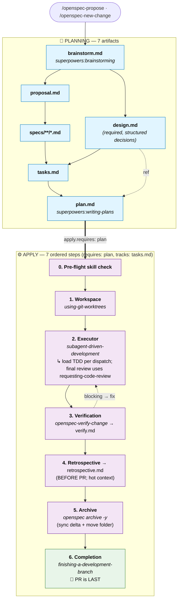

# superpowers-bridge Schema

[English](./README.md) · [繁體中文](./README.zh-TW.md)

[](https://github.com/JiangWay/openspec-schemas/actions/workflows/validate-schemas.yml)
[](https://github.com/JiangWay/openspec-schemas/issues?q=is%3Aopen+label%3Aupstream-version-check)
[](#compatibility)
[](#compatibility)

> Bridges [OpenSpec](https://github.com/Fission-AI/OpenSpec)'s artifact governance (the **what**) with [obra/superpowers](https://github.com/obra/superpowers) execution skills (the **how**) into a single workflow. Adds an evidence-first `retrospective` artifact filling a gap Superpowers does not natively cover.
>
> The integration lives entirely at the prompt layer — no Superpowers source modified, no OpenSpec CLI changes. Schema version: v1.

---

## Install

### Method 1: Claude Code one-shot prompt (recommended)

Copy and paste this into Claude Code in your project root:

```
Install the superpowers-bridge schema for OpenSpec into this project:

1. Verify the project has an `openspec/` directory (run `openspec init` if missing).
2. Clone https://github.com/JiangWay/openspec-schemas to a temp dir.
3. Copy the `superpowers-bridge/` subdirectory to `openspec/schemas/superpowers-bridge/`.
4. Run `openspec schema validate superpowers-bridge` to verify.
5. Run `openspec schemas` and confirm `superpowers-bridge` is listed.
6. If a CLAUDE.md exists at the project root, ask me whether to insert the workflow-routing fragment from `openspec/schemas/superpowers-bridge/templates/adopters/CLAUDE.md.fragment.<locale>.md` (auto-detect locale from existing CLAUDE.md content; default zh-TW for Traditional Chinese, no suffix for English). If I say yes, append the fragment as a new section. If no CLAUDE.md exists, skip.
7. Clean up the temp directory.
8. Verify Superpowers plugin is installed by running `claude plugin list`.
   If not listed, run `claude plugin install superpowers@claude-plugins-official`.
9. Show me the final state.
```

### Method 2: Manual bash (CI / non-Claude environments)

```bash
git clone https://github.com/JiangWay/openspec-schemas /tmp/oss
cp -R /tmp/oss/superpowers-bridge ~/your-project/openspec/schemas/superpowers-bridge

# Optional: insert workflow-routing fragment into CLAUDE.md
# cat /tmp/oss/superpowers-bridge/templates/adopters/CLAUDE.md.fragment.md       # English
# cat /tmp/oss/superpowers-bridge/templates/adopters/CLAUDE.md.fragment.zh-TW.md # zh-TW

rm -rf /tmp/oss
cd ~/your-project
openspec schema validate superpowers-bridge
claude plugin install superpowers@claude-plugins-official  # if not already
```

---

## Upgrading an existing install

If your project already has `openspec/schemas/superpowers-bridge/` and you want to pull the latest version, use one of the upgrade methods below. The upgrade overwrites the entire `superpowers-bridge/` directory and offers a CLAUDE.md fragment update — see "What the upgrade overwrites" below.

### Upgrade Method 1: Claude Code one-shot prompt (recommended)

In your project root, paste this into Claude Code:

```
Upgrade the superpowers-bridge schema in this project:

1. Verify `openspec/schemas/superpowers-bridge/` already exists (upgrade, not fresh install). If missing, abort and tell me to use the install instructions instead.
2. Clone https://github.com/JiangWay/openspec-schemas to a temp dir.
3. Show me the diff between the local `openspec/schemas/superpowers-bridge/` and the cloned `superpowers-bridge/` (use `diff -ruN`). Wait for my ack before overwriting.
4. After my ack, overwrite the local schema dir with the cloned one.
5. Run `openspec schema validate superpowers-bridge` to verify.
6. Check whether this project has `CLAUDE.md` at the repo root.
   - If yes: scan it for an existing workflow-routing section referencing superpowers-bridge.
     - If found: show me the diff between that section and `superpowers-bridge/templates/adopters/CLAUDE.md.fragment.<locale>.md`. Wait for my ack before replacing.
     - If not found: ask whether to insert the new fragment from `templates/adopters/CLAUDE.md.fragment.<locale>.md`.
   - If no CLAUDE.md exists: skip.
7. Clean up the temp directory.
8. Show me the final state.
```

> `<locale>` defaults to `zh-TW` if your CLAUDE.md is in Traditional Chinese, or no suffix (English). Claude detects from existing CLAUDE.md content.

### Upgrade Method 2: Manual bash

```bash
# 1. Get the latest bundle
git clone https://github.com/JiangWay/openspec-schemas /tmp/oss-upgrade

# 2. Review the diff first (don't overwrite blindly)
diff -ruN ~/your-project/openspec/schemas/superpowers-bridge /tmp/oss-upgrade/superpowers-bridge

# 3. After reviewing, overwrite
rm -rf ~/your-project/openspec/schemas/superpowers-bridge
cp -R /tmp/oss-upgrade/superpowers-bridge ~/your-project/openspec/schemas/superpowers-bridge

# 4. Validate
cd ~/your-project && openspec schema validate superpowers-bridge

# 5. CLAUDE.md fragment (manual)
# View /tmp/oss-upgrade/superpowers-bridge/templates/adopters/CLAUDE.md.fragment.md
# Compare against your CLAUDE.md and insert/update the corresponding section as needed

# 6. Clean up
rm -rf /tmp/oss-upgrade
```

### What the upgrade overwrites

| Path | Action | Manual step? |
|---|---|---|
| `openspec/schemas/superpowers-bridge/` | Auto-overwritten — entire directory replaced from upstream (`rm -rf` + `cp -R` in Method 2; equivalent in Method 1) | None |
| `CLAUDE.md` (project root) | The schema dir ships `templates/adopters/CLAUDE.md.fragment.<locale>.md`; the upgrade procedure diffs your existing CLAUDE.md against this fragment and waits for your ack before inserting / replacing | Yes — review diff, choose insert / replace / keep |

> The bridge directory is monolithic — you take the whole new version or stay on the old one. There is no per-file opt-in. CLAUDE.md is the only project-root file the upgrade ever touches, and never without your ack.

> In-flight changes (any phase: brainstorm / design / specs / ...) remain valid because the schema graph (`requires:` edges, PRECHECKs, artifact dependencies) hasn't changed in v1.x. Existing `verify.md` / `retrospective.md` from before the upgrade are still readable; if you re-run `/openspec-verify-change` or `/openspec-continue-change → retrospective` on them, the new template structure applies on overwrite.

> If a future upgrade modifies the schema graph structurally (artifact add/remove, `requires:` edge changes, PRECHECK changes), the README will gain a version field and a migration guide. v1 → v1.x prose-only changes are safe and do not need migration.

---

## What problem does this solve?

OpenSpec governs **what to do** (artifact lifecycle: proposal / specs / tasks / verify, etc.). Superpowers governs **how to do it** (execution discipline: brainstorming, writing-plans, TDD, code review). Each is solid on its own; interleaving them in real development surfaces three structural problems:

1. **Output duplication** — brainstorming writes design output to `docs/superpowers/specs/`; OpenSpec re-authors `proposal.md` / `design.md` in the change directory, with overlapping content.
2. **Task fragmentation** — OpenSpec's `tasks.md` (coarse checkboxes) and Superpowers' `plan.md` (TDD micro-steps) describe the same work in different formats, locations, and progress trackers.
3. **Manual orchestration** — the user has to decide on every step which skill to invoke; the two systems do not connect on their own.

### Why a custom schema rather than modifying existing skills?

Two alternatives were considered and rejected:

- **Adding custom fields to `config.yaml`** (e.g., `skill_bindings`): the OpenSpec CLI does not recognize them — no validation, no discoverability, requires editing multiple SKILL.md files.
- **Editing the opsx skill files directly**: invasive (affects every change) and fragile (overwritten on SKILL.md upgrade).

A custom schema uses OpenSpec's **native project-level schema mechanism**: the CLI validates structure, `openspec schemas` lists it automatically, each change picks its schema independently (`--schema spec-driven` or `--schema superpowers-bridge`), and no existing SKILL.md or command file is modified.

---

## Entry & exit gates

This schema's instructions only fire when an OpenSpec workflow skill runs `openspec instructions` (`/openspec-new-change`, `/openspec-continue-change`, and the rest). OpenSpec 2.0 removed the `/opsx:*` slash commands. OpenSpec 2.2 adds `/openspec`, a router that picks one of those skills; it does not select this schema by itself (see Usage). If you trigger Superpowers skills via narrative — for example, by saying "let's discuss the architecture" — the default behavior bypasses the schema. Brainstorming will still write to `docs/superpowers/specs/`, defeating the integration's redirection.

This section covers three things:

1. When you don't need to enter the schema at all (just open a PR)
2. When verbal brainstorming should be promoted to an opsx change
3. Front-door anti-patterns to avoid once the schema is installed

### When NOT to enter the schema (direct PR)

Not every change needs a `change` directory. The following scenarios should skip opsx entirely:

| Scenario | Need a change? | What to do |
|---|---|---|
| New feature / new capability | ✅ Yes | `/openspec-new-change <name> --schema superpowers-bridge` |
| Breaking change | ✅ Yes | Same |
| Architecture change | ✅ Yes | Same |
| Bug fix (restoring intended behavior, no contract change) | ❌ No | Direct PR |
| Test backfill / coverage | ❌ No | Direct PR |
| Build tooling tweak (linter rule, coverage threshold) | ❌ No | Direct PR |
| Non-breaking dependency upgrade | ❌ No | Direct PR |
| Documentation update / typo fix | ❌ No | Direct PR |
| Config value tweak (no structural change) | ❌ No | Direct PR |

> Principle: **process ceremony should scale with risk**. External contracts, cross-system integration, DB schema changes, compliance boundaries → run a change. Typos, bug fixes, timeout adjustments → direct PR. For ambiguous cases, use the 5-condition checklist below.

### When verbal brainstorming should be promoted to a change

If `superpowers:brainstorming` was triggered via narrative ("let's brainstorm the architecture") in a project that uses this schema, the brainstorming output **MUST NOT** land in `docs/superpowers/specs/` — that bypasses the schema's output redirection and creates orphan artifacts.

The correct flow: keep brainstorming verbally until all 5 conditions below hold, then promote to `/openspec-propose` or `/openspec-new-change` so the agreed design lands in `openspec/changes/<name>/brainstorm.md`.

1. **Scope locked** — one sentence describes what's in / out, and the scope doesn't keep growing each turn
2. **Major design forks resolved** — alternatives have been weighed and one chosen; remaining unknowns are **explicit TBDs** (with owner and impact-scope statement), not "haven't thought about it yet"
3. **Cross-system dependencies mapped** — for each dependency: ready / mockable / genuinely unknown — pick one
4. **Acceptance criteria stateable** — concrete pass conditions (e.g., `./mvnw clean verify` passes + N specific deliverables)
5. **Conversation converging** — the last 1-2 turns are confirmations, not new "what about..." forks

If any condition is missing, keep brainstorming. When all five hold:
- The model **should proactively suggest** "this looks ready for `/openspec-propose` — want to open a change?"
- The user **may also explicitly say** "open this as an opsx change"
- Either way, **promotion requires a deliberate human ack** — never automatic

### Front-door anti-patterns

| Anti-pattern | Why it's wrong |
|---|---|
| Letting brainstorming write to `docs/superpowers/specs/` after the schema is installed | Bypasses the brainstorm artifact's output redirection in [schema.yaml](./schema.yaml); produces orphan artifacts |
| Letting writing-plans write to `docs/superpowers/plans/` | Same reason (the plan artifact instruction) |
| Promoting to opsx with unresolved blocking TBDs | Those TBDs will block apply phase too — promotion just defers the same problem |
| Opening a change for bug fix / typo / config tweak | Process ceremony exceeds actual risk; slows delivery without value |

---

## Workflow & integration

### Artifact DAG

```text
brainstorm ──┬──→ proposal ──→ specs ──┐
             │                         ├──→ tasks ──→ plan ──→ [apply] ──→ verify ──→ retrospective
             └──→ design ──────────────┘
```

Differences from `spec-driven`:

| | spec-driven | superpowers-bridge |
|---|---|---|
| Entry | proposal (manual) | **brainstorm** (invokes brainstorming skill) |
| Plan layer | tasks (coarse) | tasks + **plan** (TDD micro-steps) |
| apply requires | tasks | **plan** |
| apply method | standard task-by-task | **worktree + subagent-driven-development** (TDD loaded on each implementer dispatch; per-task review is SDD's own prompt; final review uses requesting-code-review) |
| Post-apply | (none) | **verify** + **retrospective** artifacts |
| New artifacts | — | brainstorm, plan, verify, retrospective |

### Lifecycle (apply orchestration + timing notes)

The Artifact DAG above shows **file-existence** dependencies. The runtime lifecycle below adds the apply phase's ordered steps and the **timing offsets** between graph edges and actual production order.



ASCII fallback (CLI-readable):

```text
PLANNING ━━━━━━━━━━━━━━━━━━━━━━━━━━━━━━━━━━━━━━━━━━━━━━━━━━━━━━
  brainstorm.md ──┬─→ proposal.md ──→ specs/**/*.md ──┐
                  │                                   ├─→ tasks.md ──→ plan.md
                  └─→ design.md (required) ───────────┘
                                                                       │
                          apply.requires: [plan], apply.tracks: tasks  ▼
APPLY ━━━━━━━━━━━━━━━━━━━━━━━━━━━━━━━━━━━━━━━━━━━━━━━━━━━━━━━━
  0. Pre-flight skill check
  1. superpowers:using-git-worktrees
  2. superpowers:subagent-driven-development (load TDD on each dispatch; final review uses requesting-code-review)
  3. openspec-verify-change → verify.md ◄┐
                              │           │ blocking → fix
                              ▼           │
  4. retrospective.md (BEFORE PR; hot context)
  5. openspec archive -y (sync delta + move folder)
  6. superpowers:finishing-a-development-branch (🏁 PR is LAST)
```

> **Timing notes** (full rationale in "Six design touches" #6):
> - `verify.md` declares `requires: plan` in the graph but is actually produced inside apply step 3.
> - `retrospective.md` declares `requires: verify` and per Step 4 is produced **before** the PR opens — so the PR diff includes the complete archived cycle (all artifacts done, spec synced, change folder under `archive/`).
> - The `requires:` edges are file-existence dependencies for OpenSpec's graph engine; runtime ordering lives in instruction prose.

### Seven Superpowers touchpoints

| # | Superpowers skill | Where it's invoked | Trigger |
|---|---|---|---|
| 1 | `superpowers:brainstorming` | `brainstorm` artifact instruction | Direct (with PRECHECK) |
| 2 | `superpowers:writing-plans` | `plan` artifact instruction | Direct (with PRECHECK) |
| 3 | `superpowers:using-git-worktrees` | apply step 1 | Direct |
| 4 | `superpowers:subagent-driven-development` | apply step 2 | Direct |
| 5 | `superpowers:test-driven-development` | apply step 2, each implementer dispatch | Direct (v7 SDD does not load it) |
| 6 | `superpowers:requesting-code-review` | apply step 2, final whole-branch review | Direct (per-task review is SDD's own prompt) |
| 7 | `superpowers:finishing-a-development-branch` | apply step 6 | Direct |

Plus one OpenSpec built-in: `openspec-verify-change` (apply step 3). The schema instruction writes `verify.md`; the skill's own report does not.

> **No `executing-plans` executor.** This schema requires a subagent-capable platform (Claude Code, Codex, etc.) and selects `subagent-driven-development`. `superpowers:executing-plans` at v7.0.2 does load TDD and a final code review (that was not true at v5.1.0). It still runs every task in one context and reviews only at the end. This schema does not select it. If your platform lacks subagent support, use the built-in `spec-driven` schema instead.

### Output redirection

Superpowers skills have default output paths (e.g., brainstorming writes to `docs/superpowers/specs/`). This schema's artifact instructions **override** that behavior by injecting context that redirects output into the change directory:

- brainstorming → `openspec/changes/<name>/brainstorm.md`
- writing-plans → `openspec/changes/<name>/plan.md`

Implemented purely via context injection at invocation time, not by modifying skill source.

---

## Usage

OpenSpec 2.0 removed the `/opsx:*` slash commands. The names below are workflow skills. In Codex the prefix is `$` instead of `/`.

### `/openspec` router (OpenSpec 2.2)

`/openspec` is a starting-point skill. It does not replace `/openspec-propose`, `/openspec-new-change`, `/openspec-ff-change`, `/openspec-continue-change`, `/openspec-apply-change`, `/openspec-verify-change`, or `/openspec-archive-change`. It reads the request and hands it to one of those skills (or to explore, update, sync, bulk-archive, or onboard). Several steps run one skill at a time. If a skill says to stop for the user, the router stops there.

The router has no schema argument. The skill it calls uses the project default schema unless the request names one. To run this bridge:

- Set `schema: superpowers-bridge` in `openspec/config.yaml`, or
- Name it in the request, for example `/openspec new change my-feature --schema superpowers-bridge`.

A bare `/openspec add a feature` on a `spec-driven` project never enters this schema, so brainstorm, plan, and retrospective are skipped.

Once the change uses this schema, the dispatched skill follows `openspec instructions`. That is what injects the Superpowers PRECHECKs and the output redirection. `openspec-propose` and `openspec-ff-change` still stop at the artifacts apply needs (through `plan`). They do not write `verify.md` or `retrospective.md`.

`/openspec verify <name>` runs the built-in `openspec-verify-change` skill. That skill writes its own Completeness / Correctness / Coherence report. It does not write this schema's `verify.md`. Produce `verify.md` by continuing the change after apply, so `openspec instructions verify` runs.

### Quick flow (recommended)
```bash
/openspec-ff-change my-feature    # one-shot: scaffold + brainstorm + proposal + design + specs + tasks + plan
/openspec-apply-change            # worktree + subagent-driven-development (load TDD per dispatch)
/openspec-verify-change           # produces verify.md (7 checks)
/openspec-continue-change         # → retrospective (produces retrospective.md, §0 + 6 sections)
/openspec-archive-change          # archive
```

### Step-by-step flow
```bash
/openspec-new-change my-feature --schema superpowers-bridge
/openspec-continue-change         # → brainstorm (interactive dialogue)
/openspec-continue-change         # → proposal
/openspec-continue-change         # → design (reorganize brainstorm into structured decisions)
/openspec-continue-change         # → specs
/openspec-continue-change         # → tasks
/openspec-continue-change         # → plan
/openspec-apply-change            # → implementation + worktree + subagent-driven-development
/openspec-verify-change           # → verify.md (post-apply, runs the 7 checks)
/openspec-continue-change         # → retrospective.md (post-verify, evidence-first §0 + 6 sections)
/openspec-archive-change
```

### Switching back to spec-driven
```bash
# Use a different schema for one change
/openspec-new-change my-simple-fix --schema spec-driven

# Or change project default in openspec/config.yaml: schema: spec-driven
```

---

## Apply phase walkthrough

`/openspec-apply-change` triggers the steps inside [schema.yaml](./schema.yaml)'s `apply.instruction`:

#### 0. Pre-flight — verify required Superpowers skills

Confirms these skills are installed before proceeding:

- `superpowers:using-git-worktrees`
- `superpowers:subagent-driven-development`
- `superpowers:test-driven-development` (load on each implementer dispatch; v7 SDD does not)
- `superpowers:requesting-code-review` (final whole-branch review reads its code-reviewer.md)
- `superpowers:finishing-a-development-branch`

Missing skill → STOP with explicit error. No silent fallback, no manual mode within this schema. The user should either install Superpowers or switch to the built-in `spec-driven` schema for that change.

> The v0 version of this schema once placed an "auto-commit change artifacts to current branch" step here. It was removed after the [PR #970 review](https://github.com/Fission-AI/OpenSpec/pull/970): handling untracked change directories is the worktree skill's responsibility, not the schema's.

#### 1. Workspace — `superpowers:using-git-worktrees`

Creates an isolated workspace. The skill prefers a native worktree tool when the harness has one. Otherwise it uses a project-local `.worktrees/<change-name>/` after consent, confirms that directory is gitignored, switches to a new branch, runs setup, and confirms a clean test baseline.

#### 2. Executor — `superpowers:subagent-driven-development`

Main agent reads `plan.md` and dispatches a fresh implementer subagent per task. v7 SDD does not load TDD or `requesting-code-review` for you:

- **TDD** (`superpowers:test-driven-development`): the controller puts this skill on every implementer dispatch. The plan's steps are failing test → watch it fail → minimal code → pass. v7 SDD no longer deletes implementation written before a failing test on its own.
- **Per-task review**: SDD's own task-reviewer prompt (spec compliance + code quality), not `requesting-code-review`.
- **Final review** (`superpowers:requesting-code-review`): after all tasks, the whole-branch review reads that skill's `code-reviewer.md`.

Coarse `tasks.md` checkboxes tick as tasks complete.

This schema does not select `superpowers:executing-plans`. See design touch #4 below.

#### 3. Verification — `openspec-verify-change`

The verify artifact instruction writes `verify.md` from 7 checks: structural validation (`openspec validate --all --json`), task completion, delta-spec sync state, design/specs coherence (non-blocking warning), implementation signal (committed code), front-door routing leak detector (non-blocking warning), and deferred-dogfood vs automated-test equivalence. The last check blocks only when `plan.md` has `[~]` deferrals but the equivalence section is empty (gap analysis skipped); otherwise it is informational. The built-in `openspec-verify-change` report does not replace that file. `/openspec verify` (the 2.2 router) runs that skill and stops at its report; `verify.md` is written when this artifact's instruction runs.

Failures route back to the corresponding artifact for fix; verify can be re-run.

> **Steps 4–6 are the canonical post-verify sequence: retro → archive → PR. Reordering produces incomplete PRs (retrospective + archive land as trailing post-merge commits, losing hot context).**

#### 4. Retrospective — `retrospective` artifact (recommended; per Entry & exit gates skip rules, trivial fixes may skip)

Evidence-first reflection: §0 Evidence (quantitative front-matter — commit count, diff size, tasks-done ratio, dependencies, validate state, etc.) plus 6 analysis sections (Wins / Misses / Plan deviations / Skill compliance / Surprises / Promote candidates). Each claim cites a commit / file / measurable fact, typically referencing §0 instead of inlining evidence per bullet. The procedure is embedded in the artifact's instruction — no external skill required (Decision 3 in the design spec defers Claude Code plugin packaging to v1.x).

Written **before** opening the PR so retro lands in the same PR diff.

#### 5. Archive — `openspec archive -y` (or `/openspec-archive-change`)

Syncs delta specs into `openspec/specs/<capability>/spec.md` and moves the change folder to `openspec/changes/archive/YYYY-MM-DD-<name>/`. Run **before** the PR opens so the diff reflects the complete archived cycle (all artifacts done, spec synced, folder under archive/).

#### 6. Completion — `superpowers:finishing-a-development-branch`

Confirms tests are green, then presents three options: merge back to the base branch, push and open a pull request, or keep the branch. Discard is only on an explicit request, with a typed confirmation. The skill is forge-neutral (it does not hardcode `gh pr create`). It then cleans up the worktree. **PR is the last step** — if retro or archive haven't been done, finish them first.

---

## CLI cheat sheet

| Scenario | Command |
|---|---|
| Skill not named (OpenSpec 2.2 router) | `/openspec <request>`. Name `superpowers-bridge`, or set it as the project default. Otherwise the change uses `spec-driven`. |
| First clone of a project | `bash scripts/install-git-hooks.sh` |
| New change (interactive) | `/openspec-new-change <name> --schema superpowers-bridge` then `/openspec-continue-change` |
| New change (one-shot) | `/openspec-ff-change <name>` |
| Resume an interrupted change | `/openspec-continue-change <name>` |
| Enter implementation | `/openspec-apply-change <name>` |
| Manual verify | `/openspec-verify-change <name>` |
| Archive | `/openspec-archive-change <name>` |
| Use built-in (skip brainstorm) | `/openspec-new-change <name> --schema spec-driven` |
| List all schemas in the project | `openspec schemas` |
| Inspect a change's progress | `openspec status --change <name> --json` |
| List active changes | `openspec list` |
| Validate the entire project | `openspec validate --all --json` |

---

## Six design touches worth remembering

### 1. Skill-name PRECHECK (Layer 1 capability detection)

Each artifact / apply step that invokes a Superpowers skill runs a PRECHECK at the start of its instruction, confirming the skill exists in the LLM's available skills list. **Missing skill = STOP, no silent fallback.** This is the concrete answer to layer 1 of [PR #970 review](https://github.com/Fission-AI/OpenSpec/pull/970)'s concern #1 — fail loud, fail early.

### 2. Schema-level vs prompt-level integration

Integration lives entirely in `instruction:` fields (pure prompts). A skill behavior change that the instruction does not describe does not require a schema edit. We edit `schema.yaml` when a skill is renamed or removed, or when an instruction states a behavior upstream no longer has. The 2026-11-25 edit is the second case: v7 stopped auto-loading TDD inside subagent-driven-development, and v7 brainstorming chains into writing-plans.

### 3. TDD and review are named, not assumed

v5 `subagent-driven-development` listed TDD and `requesting-code-review` as skills it activated. v7 does not. The apply instruction now says where each one actually runs: TDD on every implementer dispatch, SDD's own prompt for the per-task review, and `requesting-code-review`'s `code-reviewer.md` for the final whole-branch review.

### 4. Opinionated: subagent platforms only, no inline executor

This schema requires a subagent-capable platform (Claude Code, Codex, etc.) and selects `subagent-driven-development`. At v5.1.0, `superpowers:executing-plans` did not mention TDD or code review. At v7.0.2 it loads `test-driven-development` and does one final review, and it still has no fresh subagent per task and no per-task review. This schema does not select it. If the platform has no subagent support, use the built-in `spec-driven` schema.

### 5. Evidence-based PRECHECK for verify and retrospective (Layer 2 capability detection)

Each timing-sensitive artifact runs concrete shell evidence checks at the start of its instruction:

- **verify**: `git rev-list --count <base>..HEAD > 0` AND `grep -c '^- \[x\]' tasks.md > 0`. `<base>` is the merge-base with the first existing ref among `origin/HEAD`, `origin/main`, `origin/master`, `main`, `master`, so fresh repositories without a remote fall back to the local default branch; if none exists, the agent asks the user for the base branch instead of treating the result as 0.
- **retrospective**: `test -f verify.md` AND `! grep -q '^- \[x\] ❌ FAIL' verify.md`

The LLM does not need to interpret timing prose — it runs commands and reads results. This is layer 2 of concern #1 / mitigation for concern #2.

### 6. verify and retrospective are time-mismatched artifacts (known limitation)

`verify.requires: [plan]` and `retrospective.requires: [verify]` are file-existence dependencies in the schema graph, but each instruction explicitly states "MUST run AFTER apply phase / verify pass". This is intentional misalignment — OpenSpec's engine only checks predecessor file existence. Engine-native fix awaits a `post_apply` phase concept upstream (analogous to spec-kit's `after_implement` hook); evidence-based PRECHECK above is the v1 mitigation.

---

## Versioning

This bundle carries **two version identifiers** that should not be confused:

| Identifier | Where | Meaning | Example |
|---|---|---|---|
| Schema major | `schema.yaml: version: 1` | Contract of the schema graph (artifacts, `requires:` edges, PRECHECK shape). Breaking changes bump this. | `1` |
| Bundle release | `VERSION` file + git tag | SemVer release of this bundle, scoped to a schema major. | `1.0.0` (tagged `v1.0.0`) |

A bundle release `1.x.y` is a published cut of schema major `v1`. A future schema major `v2` will restart bundle releases at `2.0.0`. Adopters who pin to `v1.x.y` are guaranteed schema-graph compatibility within the v1 major.

> The compatibility matrix below uses `v1` (schema major) as the row key, because compatibility with OpenSpec / Superpowers is governed by the schema contract, not by patch-level edits inside this bundle.

## Compatibility

Baseline versions this schema was authored against. This is a **historical snapshot, not an end-to-end compatibility guarantee** — CI cannot run the full prompt-layer workflow in headless mode, so behavioral compatibility relies on human review when drift fires.

Current bundle release: **`1.0.0`** (git tag `v1.0.0`; see [VERSION](./VERSION)).

| superpowers-bridge | OpenSpec CLI | Superpowers plugin | Baseline as of |
|---|---|---|---|
| v1 | `2.2.0` | `v7.0.2` | 2026-11-26 |

### How this is checked

The contract is three layers — **baseline declaration + automated drift detection + human review** — not automated compatibility enforcement.

| Layer | Mechanism | Catches | When it fires |
|---|---|---|---|
| Structural | [`validate-schemas.yml`](../.github/workflows/validate-schemas.yml) on every push/PR; [`version-check.yml`](../.github/workflows/version-check.yml) weekly against latest OpenSpec | Schema-graph breaks (field renames, removed `requires:` edges, PRECHECK syntax changes) | CI run fails red |
| Drift notification | [`version-check.yml`](../.github/workflows/version-check.yml) weekly, compares baseline above against latest npm / GitHub release | Pinned ≠ latest upstream | Opens / updates a [labelled drift issue](https://github.com/JiangWay/openspec-schemas/issues?q=is%3Aopen+label%3Aupstream-version-check) for human review (workflow stays green — drift is normal, not a failure) |
| End-to-end workflow | **Not automated** | Behavioral changes inside Superpowers skills (renames, prose rewrites altering PRECHECK semantics, transitive-dependency changes); subtle OpenSpec engine semantic shifts | A human reads upstream release notes when the drift issue fires |

The 2026-11-26 date is a headless re-verification against the versions in the table: `openspec schema validate superpowers-bridge` on OpenSpec 2.2.0, a dogfood change whose artifact and apply instructions resolve, a diff of OpenSpec 2.2.0 against 2.1.1, and a source read of the bound Superpowers skills at v7.0.2. It is not an interactive end-to-end cycle (brainstorm dialogue, subagent apply, pull request). That cycle is still a human check.

### Known breaking changes

Reviewed 2026-11-26, OpenSpec `1.4.1` → `2.2.0` and Superpowers `v5.1.0` → `v7.0.2`. npm `@fission-ai/openspec` is `2.2.0`. The newest GitHub release of obra/superpowers is still `v7.0.2` (2026-11-03). The schema graph (artifact ids, `requires:` edges, PRECHECK-before-invoke) is unchanged from 2.1.1 to 2.2.0 (`src/core/artifact-graph` is identical), so schema major stays `1`. These are the user-facing and behavioral breaks.

**OpenSpec 2.0.0 (2026-11-11) removed `/opsx:*` slash commands.** The workflows are the same skills:

| Removed command | Skill (OpenSpec 2.x) |
|---|---|
| `/opsx:new` | `/openspec-new-change` |
| `/opsx:ff` | `/openspec-ff-change` |
| `/opsx:propose` | `/openspec-propose` |
| `/opsx:continue` | `/openspec-continue-change` |
| `/opsx:apply` | `/openspec-apply-change` |
| `/opsx:verify` | `/openspec-verify-change` |
| `/opsx:archive` | `/openspec-archive-change` |

`openspec schema validate`, `openspec new change`, `openspec status`, `openspec instructions`, `openspec validate --all --json`, and `openspec archive -y` still work. `openspec-verify-change` still exists. Its report is Completeness / Correctness / Coherence and does not replace this schema's `verify.md` template.

**Superpowers v7.0.0 rewrote `brainstorming`.** The skill writes a design document (intent, goals, constraints, approaches, decisions) to `docs/superpowers/specs/YYYY-MM-DD-<topic>-design.md`, then tells the agent to invoke `writing-plans`. This schema still redirects that document into `brainstorm.md`, still forbids `design.md` at that step, and now tells the agent not to follow the writing-plans handoff. The older Q1–Qn decision log is no longer the default shape.

**Superpowers v6–v7 changed how TDD and review attach.** Checked against `skills/*/SKILL.md` at tag `v7.0.2`:

- Every bound skill name still exists: `brainstorming`, `writing-plans`, `using-git-worktrees`, `subagent-driven-development`, `test-driven-development`, `requesting-code-review`, `finishing-a-development-branch`, `executing-plans`. None were renamed or removed. v7 added `diagnosing-superpowers`, which this schema does not call.
- `subagent-driven-development` no longer loads `test-driven-development`, and it no longer deletes code written before a failing test. Per-task review is its own task-reviewer prompt. The final whole-branch review still uses `requesting-code-review`'s `code-reviewer.md`. Apply instructions now require the controller to load TDD on each implementer dispatch.
- `executing-plans` (rebuilt in v6.4) does load TDD and a final code review. It still has no fresh subagent per task and no per-task review. This schema still does not select it. The previous claim that its SKILL.md omits TDD and code review was true at v5.1.0 and is false at v7.0.2.
- `writing-plans` still defaults to `docs/superpowers/plans/`. A task is one test cycle plus a review gate, not a 2–5 minute micro-step. The plan template now includes the v7 header (Spec, Global Constraints, Review Focus) and locks the executor to subagent-driven-development.
- `using-git-worktrees` still defaults to a project-local `.worktrees/` and now prefers a native worktree tool and asks before creating one.
- `finishing-a-development-branch` no longer offers Discard on the default menu (v6.2) and does not hardcode `gh pr create`.

**OpenSpec 2.2.0 (2026-11-24) added the `/openspec` router.** The only skill-tree change from 2.1.1 is `skills/openspec/`. The twelve workflow skills are unchanged. The router complements them: it dispatches to `openspec-explore`, `openspec-propose`, `openspec-new-change`, `openspec-continue-change`, `openspec-ff-change`, `openspec-update-change`, `openspec-apply-change`, `openspec-verify-change`, `openspec-sync-specs`, `openspec-archive-change`, `openspec-bulk-archive-change`, or `openspec-onboard`. It does not select a custom schema. This schema's `schema.yaml` format is unchanged. See Usage for how a request reaches `superpowers-bridge`.

No schema-graph migration is required for in-flight v1 changes. Re-copy the bundle so instructions and templates pick up the corrections, and use OpenSpec ≥ 2.0 so the skill names in this README exist.

For adopters: pin to versions ≥ those listed above. To inspect your own project's runtime state, run `openspec list` + `openspec schemas` + `claude plugin list`.

---

## Design decisions worth knowing

### Why `brainstorm` is an artifact, not a hook

Brainstorming is multi-turn interactive dialogue requiring user participation. Modeling it as the first artifact (rather than a schema-level hook) gives two advantages:

1. **Skippable** — if the user already knows what to build, they can author `brainstorm.md` directly without invoking the skill.
2. **Trackable** — `openspec status` reports brainstorm completion, and downstream artifacts have explicit dependencies on it.

### Why `plan` is separate from `tasks`

`tasks.md` is a coarse checkbox ("Add PdfServiceTest"); `plan.md` is micro-steps ("scaffold test → write downloadPdf test → run → commit"). They serve different purposes:

- `tasks.md` → tracks overall progress (apply phase's `tracks` field parses these checkboxes)
- `plan.md` → guides subagents step by step (the executor's input)

Apply requires `plan` (not `tasks`) because the executor needs micro-steps; `tracks: tasks.md` ensures progress is still surfaced via the coarse checkboxes.

### Fallback strategy

If a Superpowers skill is unavailable:

- **`brainstorm` / `plan` artifacts** — the user may explicitly opt in to writing the artifact manually (PRECHECK STOPs and informs the user; manual override requires deliberate user action, not silent degradation)
- **`apply` phase** — no manual fallback within this schema. PRECHECK STOPs at Step 0 if any required skill is missing. The recommended path is to switch to the built-in `spec-driven` schema for that change. Rationale: see Design touch #4 above — this schema selects per-task subagents, and `executing-plans` is the inline executor.

---

## Related

- [schema.yaml](./schema.yaml) — machine-readable schema definition
- [templates/](./templates/) — markdown templates per artifact
- [README.zh-TW.md](./README.zh-TW.md) — 繁體中文版
- [obra/superpowers](https://github.com/obra/superpowers) — Superpowers skill source
- [Fission-AI/OpenSpec](https://github.com/Fission-AI/OpenSpec) — OpenSpec
- [OpenSpec PR #970](https://github.com/Fission-AI/OpenSpec/pull/970) — original review thread that drove this design
